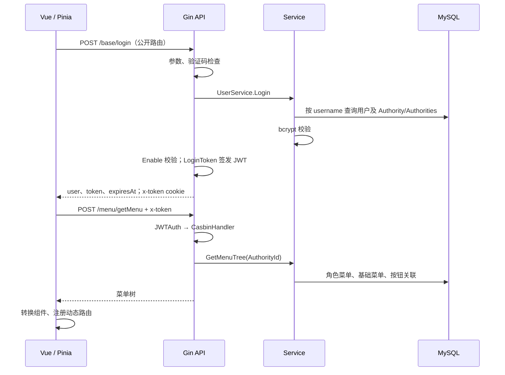

# 固定 SHA 的身份与权限链路

逐个打开以下本地源码核查；适用版本见 UPSTREAM.md。

| 阶段 | 源码与核实结果 |
|---|---|
| 启动 | `server/main.go` initializeSystem → core.Viper / initialize.Gorm → core.RunServer；`initialize/router.go` 注册公开/私有组 |
| 登录请求 | `web/src/api/user.js` login → `/base/login`；`pinia/modules/user.js` LoginIn 保存 token 与 user，随后 SetAsyncRouter |
| 请求携带身份 | `web/src/utils/request.js` 请求头 x-token；`server/utils/claims.go` GetToken 优先 header、其次 cookie |
| 后端登录 | `router/system/sys_base.go` → `api/v1/system/sys_user.go` Login → `service/system/sys_user.go` Login；查询 sys_users 并预加载角色，bcrypt 校验；API 检查 Enable |
| JWT | API TokenNext → `utils/claims.go` LoginToken → `utils/jwt.go` CreateClaims/CreateToken/ParseToken；中间件将 claims 放入 Gin context，并在缓冲期刷新 |
| 路由鉴权 | `initialize/router.go` PrivateGroup.Use(JWTAuth).Use(CasbinHandler)；`middleware/jwt.go` 校验 token 与进程黑名单 |
| Casbin | `middleware/casbin_rbac.go` AuthorityId + 去前缀 PATH + HTTP method → Enforce；`utils/casbin_util.go` 模型 r=sub,obj,act，GORM adapter 读取策略，未包含 tenant domain |
| 动态菜单 | `web/src/api/menu.js` → `/menu/getMenu` → `router/system/sys_menu.go` → `api/v1/system/sys_menu.go` GetMenu → `service/system/sys_menu.go` GetMenuTree/getMenuTreeMap；依据角色查询 sys_authority_menus、sys_base_menus、sys_authority_btns |
| 前端导航 | `pinia/modules/router.js` SetAsyncRouter + `utils/asyncRouter.js` 解析组件；`permission.js` 路由守卫；菜单不是后端授权 |

Day 1 发现的边界：上游没有可信 TenantContext/tenant domain/企业成员校验；JWT 中逐请求用户禁用检查处于注释状态。登录时检查 Enable 不代表旧 token 实时撤销。上游文件静态服务也不等于私有业务附件代理。`/health` 仅返回进程存活，不证明 MySQL 可用。以上留到对应计划日实现，不在 Day 1 擅自改写上游权限。

Go module 定义依赖身份与导入路径，package 划分编译单元；保留原 module 可以直接核查上游差异。模块化单体让授权和多表事务留在一个进程/数据库内，当前无需分布式事务与额外消息基础设施。
