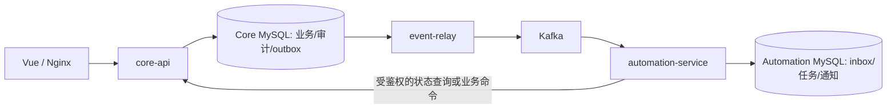

# DealFlow CRM：可靠闭环与分阶段服务化实施计划

**2026-11-08 当前按每日清单执行 Day 2。本文保留为后续路线，S1 实验代码与脚本继续归档。**

修订日期：2026-10-24。用户确认：新增订阅套餐、工作流、异步任务、微服务、Kafka、Kubernetes；本轮更新整体计划并开始第一个可运行阶段。本文为当前范围与顺序的主入口，覆盖原 56 天计划中“微服务/K8s 延后、本期不采用消息中间件”的约束；原有业务不变量继续生效。Day 1 历史记录不改写为已实现新功能。

## 1. 最终交付与预算

目标闭环：企业开通套餐 → 成员与权限 → 客户/商机 → 冻结合同版本 → 配置化审批 → 确认订单/生成应收 → 幂等回款/冲正 → 事件投递 → 提醒/报表 → 审计、对账与故障恢复。

订阅是平台与企业之间的模拟服务合同；客户回款是企业与其客户之间的业务。两种资金口径与权限必须分开。初期仍不接真实支付、银行、税务、电子签章。套餐计费与工作流规则可演示，不能据此声称可承接真实财务业务。

原 56 天约 200 小时只覆盖核心单体范围。新增分布式交付按 **12–16 周、约 300–420 小时**作为规划区间，含原计划投入；这是估算，不是完成承诺。初次接触 Go、Kafka 或 K8s 应延长。依验收门槛推进，不能以日期到达替代测试通过。

## 2. 服务边界与数据所有权

| 部署单元 | 权威数据/职责 | 一致性边界 |
|---|---|---|
| core-api（GVA 扩展） | 身份、租户/成员/套餐、CRM、合同版本、审批决策、订单/应收/回款、审计、outbox | 额度、余额、审批和业务审计保留 MySQL 本地事务 |
| event-relay | 读取 core outbox、租约领取、发布 Kafka、确认投递 | 不生成新业务事实；失败可重投；仅授予 outbox 所需权限 |
| automation-service | 持久任务、inbox、站内通知、提醒、异步导出元数据 | 自有数据库；inbox 与副作用记录同事务；不跨库写 core |
| Vue / Nginx | 三类角色入口、反代与静态资源 | 后端重新鉴权，菜单不是权限证明 |
| Kafka | 事件传输、消费组、重放 | 不作为余额、订阅权益和审批的权威数据库 |

服务化首期为 core-api + automation-service 两个业务服务，加 relay 运维进程；它们可独立构建与发布。代码先保持同仓，避免提前制造大量共享 SDK。合同、订单与回款不拆成三个写服务，以保留已知的金额事务边界。需要继续拆分时另做 ADR、Saga/补偿与对账验收，不能直接删掉数据库事务。

上图是目标架构，不代表今天已经部署。首阶段使用受信本地操作员 CLI 和本地 relay→consumer 回调传输，两个独立数据库。尚无 HTTP 权限入口、独立网络消费者或 Kafka，不能把此适配器称为已完成微服务。

## 3. 套餐、工作流与异步需求

**订阅套餐**：free/pro/enterprise 示例席位 3/10/50；套餐定义版本与企业权益快照分开。首购、模拟支付确认、续期命令幂等；升级/降级明确生效时点；席位并发锁同一资源；降级超限保留成员并阻止新增。active/expired/suspended 状态在 API 与关键事务重新核验；价格用整数分，模拟订阅收入与企业回款分账。

**工作流**：先完成原固定单步审批，再扩展有版本的配置模板。首版只支持顺序审批节点、按金额阈值选择审批链、拒绝/撤回/超时提醒；模板发布后不可原地修改，实例冻结模板版本与合同 revision，逐步检查当前审批人权限、禁止自审。暂不做任意脚本、循环图、并行会签或拖拽 BPMN 编辑器。流程运行时与核心合同决策初期同进程同事务，异步提醒由 automation 处理；上游 AI workflow session 不是此业务审批引擎。

**异步任务**：独立 worker、租约/claim token、有限退避、任务超时、取消和人工重试、终态错误与脱敏审计。延迟与调度状态存 MySQL，Kafka 用于传输已到期的命令/事件，不把它当延时队列。导出创建、执行、下载分别重新授权。提醒执行前复核客户/租户/成员和未收余额，不能只信事件中的旧权限。

## 4. 可靠性协议

1. 命令在同一数据库事务中写业务、幂等结果、审计、outbox；提交前不发布消息。
2. relay 租约领取，Kafka 确认后才标记 published。发布成功但确认前宕机会重投，event_id 保持不变。
3. 消费服务在自己的事务中写唯一 inbox 与副作用记录，成功提交后再提交消费 offset；失败不得提前确认。
4. event_id 全局唯一，事件携带 tenant_id、schema_version、aggregate_id/version、occurred_at、trace_id。首阶段仅实现订阅事件的最小字段集；Kafka 接入前补齐通用信封和兼容性规则。
5. 同 event_id 不同内容/租户拒绝；不同 event_id 同业务命令仍需业务唯一键。Kafka 分区键为 tenant + aggregate，应用仍校验版本、处理重复和乱序。
6. 毒消息隔离并记录原因；有序依赖事件出现版本缺口时暂停该聚合并补查，不能跳过后声称状态正确。人工重放有权限、范围、次数和审计。
7. 本项目采用至少一次传递与数据库幂等副作用。Kafka 的事务不能自动覆盖外部 MySQL 写入；详见 [Kafka 官方交付语义](https://kafka.apache.org/41/design/design/)。

## 5. Kubernetes 交付范围

先用 Compose 验证实际镜像和 Kafka，再部署 kind/k3d 单节点演示环境；云集群和真实费用另行安排。core/relay/automation 使用独立 Deployment、Service、配置与凭据；服务账号最小权限、NetworkPolicy、资源 requests/limits、startup/readiness/liveness、终止宽限与优雅退出。readiness 判断能否接流量，liveness 不因短暂 Kafka/数据库故障触发重启风暴；依据 [Kubernetes 探针说明](https://kubernetes.io/docs/concepts/workloads/pods/probes/)。

MySQL/Kafka 开发环境可使用持久卷和 StatefulSet/受支持部署方式，记录版本、镜像 digest、存储容量与备份恢复步骤。单节点或单副本不标注高可用。迁移用单独 Job 与迁移锁；滚动发布不能让每个 Pod 任意改表。Kafka 故障允许业务事务积压 outbox，到达明确积压容量门槛后有背压策略。HPA/PDB 不替代容量与恢复测试。

## 6. 分阶段执行与退出门槛

| 阶段 | 预计安排 | 可运行交付与门槛 |
|---|---|---|
| S1 待恢复 | 1–2 个工作块 | 本地模拟套餐开通 → 事务 outbox → 独立 worker → 消费 inbox/开通待办；此前实验及运行说明已归档，暂不纳入 Day 1 |
| S2 身份与工程底座 | 第 1–2 周余下部分 | 原 Day 2–9：版本迁移、测试库、CI、可信租户/成员、平台边界、数据范围；S1 实验表不直接作为正式租户模型 |
| S3 核心闭环 | 第 3–6 周 | 原 Day 10–28：CRM、合同冻结审批、订单应收、回款冲正；T01–T11 的数据库后置断言通过，完整浏览器闭环 |
| S4 套餐与配置工作流 | 第 7–9 周 | 原 Day 29–35 扩展：套餐快照/续期/席位、配置化审批实例、过期与撤权、拒绝和撤回；核心回归保持通过 |
| S5 Kafka 与独立异步服务 | 第 10–12 周 | 原 Day 36–42 扩展：真实 Kafka、独立消费进程/库/账号、消费者组重平衡、重复/乱序/积压、提醒与私有导出；故障注入无漏账、无重复副作用 |
| S6 K8s 与交付证据 | 第 13–16 周 | Compose→K8s，滚动升级、Pod 故障、持久卷/备份恢复、版本兼容、完整回归和性能测量；再形成最终发布 |

阶段之间可调整估时，不能跳过正确性门槛。原第 7–8 周的回归、性能、文档工作应贯穿各阶段，最终发布顺延到 S6，不再称 Day 56 已完成全部分布式范围。

## 7. 新增验收矩阵

保留原 T01–T16；新增以下检查，标记“规划”的项目不算已通过。

| 编号 | 场景 | 门槛/所在阶段 |
|---|---|---|
| E01 | 同租户同幂等键并发开通、不同内容重用键 | 同一订阅与事件，冲突无变更；S1 本地模拟验证，S4 补授权与续期 |
| E02 | 业务写入后 outbox 写失败 | 业务、命令、审计、事件全回滚；S1 |
| E03 | inbox 写入后副作用失败 | inbox 不提前完成；恢复后可以重试；S1 |
| E04 | 消费已提交，relay 确认前崩溃 | 重投只有一个开通待办；S1，S5 使用真实 broker 再验 |
| E05 | 双 worker、租约过期、旧 worker 恢复 | 不覆盖新租约，重试上限不丢事件；S1 |
| E06 | Kafka 停机/重启、重平衡、乱序与毒消息 | 可恢复消费，offset 与副作用一致，版本缺口有处理；S5，规划 |
| E07 | 模板升级、自审、旧实例审批、超时重试 | 冻结版本不变，只有一次有效决策；S4，规划 |
| E08 | 升降级/到期与关键业务写并发 | 已定义线性化与生效边界，无越权、超席位；S4，规划 |
| E09 | K8s 滚动更新与终止正在处理消息的 Pod | 不丢事件，不重复副作用；S6，规划 |
| E10 | 备份恢复、镜像回退、迁移版本不兼容 | 数据可对账，失败明确、无自动清空；S6，规划 |

## 8. 当前环境与下一步

已有 Go/Node/MySQL 和 Day 1 原始前后端。未发现 Docker、kubectl、Helm；Kafka/K8s 尚未部署，不提前创建云资源。S1 利用专用 MySQL schema 验证协议，后续运行环境按 S2/S5/S6准备。每次进度记录列明实际命令、结果、未完成项以及使用了哪种传输方式。
