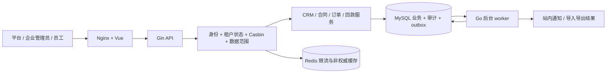
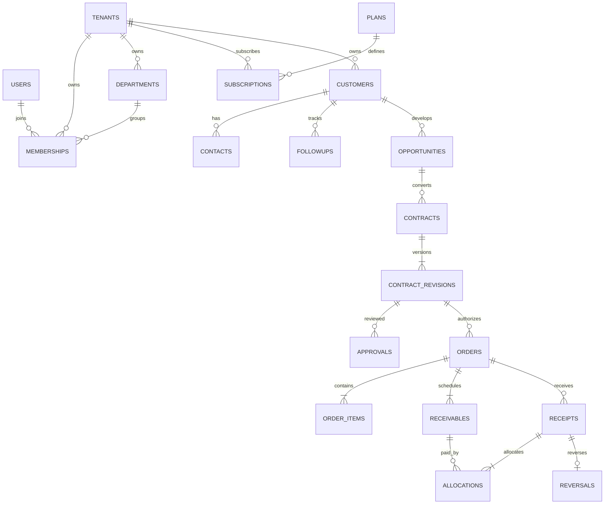

# DealFlow CRM：多租户企业销售与回款 SaaS 项目总计划

配套：[56 天每日计划](./DealFlow-CRM-56天每日计划.md) · [面试与 AI 协作手册](./DealFlow-CRM-面试与AI协作手册.md)。

制定日期：2026-10-24。本文是待执行的项目设计与验收标准，不代表功能、测试或性能数据已经实现。

2026-10-25 最新要求：当前先只做到 Day 1。下述业务与服务化内容仅保留为后续规划，后续实现暂停；此前 S1 实验已归档，不纳入当前应用源码。

2026-10-24 范围修订：用户新增订阅套餐、配置化工作流、异步任务、微服务、Kafka、Kubernetes，并选择“更新整体计划并开始第一个可运行阶段”。当前顺序、预算、服务边界与新增验收以 [扩展实施计划](./DealFlow-CRM-扩展实施计划.md) 为准。核心业务不变量继续生效；56 天仅为原核心阶段参考。

## 1. 定位与投入

**基于 GVA 扩展一个多租户销售业务平台，用客户 → 商机 → 合同审批 → 订单 → 应收 → 回款闭环，证明数据隔离、权限、事务和工程交付能力。**

建议仓库名 `dealflow-crm`，中文名「企销云」。面向 Go Web 后端、业务型 SaaS 后端及 Go + Vue 全栈岗位；Vue 是完整业务交付的一部分，主要技术深度放在后端。

按已有 Python/后端基础、每周 6 天 × 约 4 小时 + 1 天轻量复盘安排，原核心范围为 56 天、约 200 小时。新增范围估算为 12–16 周、约 300–420 小时，见扩展实施计划；Go 或分布式基础陌生应延长。AI 可以辅助阅读、实现与验证，你必须能独立解释授权、事务和失败处理。

不能承诺一个项目覆盖“绝大多数岗位”或替代工作经验。作为能力抽样，统信的软件企业招聘页面明确涉及 Go Web 框架、认证授权、数据库、Redis、容器化和稳定性；部分岗位还要求多年经验。这份计划把这些工程能力转成作品证据，不把某条岗位要求当成全市场统计。[岗位原文](https://uniontech.com/m/zhaopin-info/1840.html)

最终价值不是后台有多少页面，而是能展示：

1. 企业 A 无法读取或修改企业 B 的列表、详情、关联数据、报表、导出和附件。
2. 同企业普通销售不能审批自己的合同、查询别人的客户或登记回款。
3. 合同审批绑定具体版本，不能通过修改金额绕过审批。
4. 重复和并发提交不会重复生成订单、超占合同额度或超收款。
5. 关键业务、审计和待执行事件在同一事务提交；失败可以复现和解释。
6. 新机器可按文档启动，测试、演示数据、压测脚本与结果都能复现。

## 2. 原核心阶段与扩展范围

| 优先级 | 必须做到什么 | 明确边界 |
|---|---|---|
| P0 第 1–4 周 | 租户隔离、部门/角色/数据范围、CRM、固定合同审批、订单应收、回款及冲正、基础报表 | 不以生成 CRUD 代替业务规则 |
| P1 第 5–6 周 | 自助注册、套餐席位和功能权限、租户到期、提醒和重试、有限 Excel 导入导出、审计检索 | 订阅收入模拟；站内通知优先 |
| P0 第 7–8 周 | 隔离与并发回归、性能测量、Docker/CI、演示、技术说明和面试 | 不能为了多做页面挤掉验证 |
| 新增分期目标 | 配置化顺序审批、独立异步服务、Kafka、Kubernetes | 按扩展实施计划 S4–S6 验收，不挤掉核心正确性测试 |
| 延后 | 可视化流程设计器、任意脚本/循环工作流、真实支付/银行/电子签章、发票税务、会计总账、分库分表、AI 助手 | 不在当前扩展范围 |

先完成固定审批，再在 S4 增加模板版本、金额分支与顺序审批节点；不实现任意脚本或完整 BPMN 引擎。订单是销售合同履约与应收来源，不叠加商城、购物车和完整库存系统。

第 28 天若核心没有通过，暂停套餐美化、自动化扩展，优先修好核心。可以减少报表图表、只保留单步审批和一种导入模板，不能删隔离、金额与事务测试。

## 3. GVA 复用方式

GVA 官方仓库列出 Vue 3、Gin、JWT、权限、动态路由、上传下载、代码生成等能力，并支持 TS/JS 混用。这里复用的是开发底座；它不等于本项目已经具备完整的租户业务隔离。[GVA 官方仓库](https://github.com/flipped-aurora/gin-vue-admin)

Day 1 固定实际选用的 tag/commit SHA，记录 Go/Node/MySQL 版本及锁文件，核查该版本目录、鉴权和菜单链路。不要根据教程或最新主分支猜测接口。保留上游 LICENSE 和适用声明，写 `UPSTREAM.md` 列明来源、版本与改造点。

| 直接复用并核查 | 自己实现且必须能解释 |
|---|---|
| 登录基础、JWT 工具、通用页面布局、动态菜单、Swagger、基础日志 | TenantContext、成员关系、平台与企业权限边界 |
| Casbin 基础接入、代码生成入口 | 租户 domain、记录数据范围、权限变更生效 |
| 表格表单、常规分页、文件上传工具 | 关联对象校验、私有附件访问、导入导出隔离 |
| 基础数据库与配置组织方式 | 合同版本、审批、金额、幂等、事务、回款冲正 |
| 现有基础测试/脚本 | 隔离矩阵、真实 MySQL 并发测试、压测、恢复演练 |

新业务前端用 TypeScript；不为追求“全 TS”重写全部上游页面。代码生成器只生成起点，生成后的 API 必须补授权、租户条件、字段白名单和测试。演示部署关闭初始化、在线代码生成及不需要的开发管理入口。

## 4. 技术与工程结构

| 层级 | 选择 | 用在什么地方 |
|---|---|---|
| 前端 | Vue 3、TypeScript、Vite、Vue Router、Element Plus、Pinia | 三类角色入口、业务表单、列表、状态动作与会话 |
| 后端 | Go、Gin、GVA；分阶段独立 automation-service | core 保留合同/订单/回款事务边界，异步服务独立进程和数据所有权 |
| 数据 | MySQL 8、GORM、显式版本迁移 | 关联、事务、锁、索引、可追溯金额 |
| 权限 | GVA JWT 基础 + Casbin tenant domain + 业务数据范围 | 身份、动作、租户、行权限分别检查 |
| Redis | 复用 GVA 必需用途；后期增加限流和非权威缓存 | 不作为回款、席位和审批正确性的唯一保证 |
| 异步 | Go worker + MySQL outbox/inbox + Kafka | S1 本地桥接验证协议，S5 接入真实 Kafka；RabbitMQ 不再另加 |
| 测试 | Go testing、httptest、真实 MySQL 集成测试；Vitest、Vue Test Utils、Playwright | 规则、API、并发、组件、关键浏览器流程 |
| 运维 | Docker Compose、Kubernetes、Nginx、GitHub Actions、日志/指标 | 先本地容器验证，再 K8s 发布、故障恢复与备份演练 |

下面为核心阶段的内部组织图；跨服务/Kafka 目标拓扑见扩展实施计划。



沿用选定版本的 GVA 目录，业务放到 `saas`、`crm`、`sales`、`receivables` 等清晰模块。下面是建议职责，不要求为了形式重排上游：

```text
dealflow-crm/
  server/                 # GVA 原有后端 + 业务扩展
    api/ router/ model/ service/ middleware/
    internal/tenant/      # 可信上下文与授权封装，按实际目录调整
    internal/jobs/        # worker、重试、租约
    migrations/ tests/
  web/src/
    views/platform/ views/crm/ views/sales/ views/receivables/
    api/ stores/ components/
  deploy/                 # Compose、Nginx、示例配置
  docs/                   # ER、ADR、测试矩阵、演示、性能报告
  scripts/                # seed、验证、压测入口
  .github/workflows/
  README.md UPSTREAM.md
```

Handler 做绑定与错误映射；Service 决定授权、状态、事务；Repository 接收可信 TenantContext 与事务句柄，提供已限定租户的访问。不要把全局 `DB` 随意暴露给每个业务函数。业务事务内所有写入必须使用同一个 `tx`。[GORM 事务文档](https://gorm.io/docs/transactions.html)

## 5. 三类入口与业务故事

三类入口共用一套应用和 API，不开发三个独立前端仓库。

| 入口 | 主要页面 | 授权边界 |
|---|---|---|
| 平台运营后台 | 租户列表/详情、启停、套餐、订阅模拟、平台指标、平台审计 | 只管理平台元数据，默认无企业客户/合同/回款访问权 |
| 企业管理后台 | 部门员工、角色权限、客户、商机、合同审批、订单、应收回款、报表、企业审计 | 仍受 tenant、功能权限与数据范围限制 |
| 员工工作台 | 我的客户、我的商机、待办审批、回款进度、提醒 | 销售仅看授权客户；审批人和财务有独立动作权限 |

演示企业 A「晨星设备」和企业 B「远舟服务」，使用明显不同的假数据。A 的销售 Alice 建客户与商机，经理 Bob 审合同，财务 Carol 登记回款；B 的用户看不到这些记录。管理员同样不能绕过金额约束或随意改已审批合同。

## 6. 多租户与权限：第一周就开始验证

### 6.1 身份、租户、角色的模型

复用 GVA 用户身份，新增 `tenant_memberships`：一个用户可以加入不同企业，角色和部门挂在成员关系上。JWT 当前租户只是选择线索，服务端每次核查成员归属、状态、权限版本与租户状态。不能把客户端传入的 `tenant_id` 当授权依据。

平台管理员使用独立权限上下文/路由组，与企业角色分开；同样叫 admin 的角色不具有跨租户含义。租户业务可使用独立 Casbin 模型与策略表，避免直接破坏 GVA 系统管理权限。tenant domain 是角色生效范围；SQL 行过滤仍需单独做。[Casbin domains](https://casbin.org/docs/rbac-with-domains/)

可信 `TenantContext` 至少包含 tenantID、userID、membershipID、权限版本、数据范围。缺失或无效就拒绝，不允许“无租户条件表示查全部”。后台任务也必须显式构造并校验上下文。

初版每次请求从数据库核查活动成员/租户状态和权限版本，减少缓存撤权复杂度。角色修改提交后，新授权检查读取新状态；已经开始执行的请求不承诺瞬时撤销。回款/审批等关键操作在事务中再次校验必要状态，明确其与禁用操作的锁顺序。后期缓存只能在定义好失效窗口后引入。

### 6.2 数据范围

范围取 SELF、DEPARTMENT、DEPARTMENT_AND_CHILDREN、ALL 四种；同一动作多个允许角色的范围取并集，再与 tenant 条件取交集。显式拒绝规则本期不实现，避免混淆优先级。

客户为业务访问根：商机、合同、订单、应收和回款通过关联客户判断可见性。财务被授予本企业全部客户对应的回款动作和必要字段，销售没有回款写权限。客户转移负责人/部门后后续请求按新归属计算，不依赖各子单据过时的 owner 副本。审批待办也不能绕过当前授权。

菜单隐藏仅改善体验。权限必须覆盖 API 方法、对象 ID、字段白名单、批量操作、关联对象、导出和附件。不能只测“列表没显示”。

### 6.3 数据库与旁路

- 所有租户业务表 `tenant_id NOT NULL`。关联子表同样带 tenant_id；父表有唯一 `(tenant_id, id)`，子表建立对应复合外键，防止跨企业关联。
- GORM Scope 可复用租户过滤，但不是数据库自动安全屏障。Preload、JOIN、原生 SQL、更新删除、聚合和批量操作逐条审查；缺上下文的 Repository 返回错误。[GORM Scopes](https://gorm.io/docs/scopes.html)
- 编号唯一范围如 `(tenant_id, contract_no)`。本期删除后不复用业务编号，避免将可空 `deleted_at` 塞进唯一键而误以为能保证活动记录唯一。
- 缓存键包含 tenantID；涉及数据范围还要包含主体/权限版本，或直接不缓存。任务 payload、附件元数据、导出结果也带租户。
- 私有附件通过鉴权下载接口返回，禁止将合同放进公共静态 uploads 路径。下载时重新检查用户对关联对象的权限。
- 跨租户对象访问统一返回不泄漏存在性的错误；权限不足可用 403，重复请求内容冲突用 409。对外错误不包含 SQL 或内部路径。

## 7. 核心业务不变量

### 7.1 CRM 与合同

客户 → 联系人/跟进 → 商机（进行中、赢单、输单）。商机推进记录历史；输单写原因。赢单本身不直接计入回款报表，创建合同是明确动作。

合同草稿 → 待审批 → 已通过/已驳回。驳回后新建下一版本再提交。MVP 固定一位审批人，不允许申请人自审。提交时冻结该版本的金额、条款摘要与附件引用；审批关联 `revision_id`，并校验 expectedVersion。

待审批和通过版本不能直接改金额。旧审批请求不能审批新版本。已通过且生成订单的合同不支持原地修改；合同变更作为后续扩展。撤销仅允许尚未占用订单额度的合同，记录原因。

### 7.2 订单与应收

已通过合同可生成多张订单。订单草稿可编辑；确认时占用合同额度，并在一个事务中生成应收计划、审计和 outbox。

`有效已确认订单总额 <= 已批准合同金额`。以合同父记录作为统一并发锁，所有确认/取消入口遵守相同规则。不要使用“先查 SUM，后 INSERT”两步无保护逻辑。

每张订单确认时应收计划合计必须等于订单金额，各期金额 > 0；货币只做 CNY，金额用 Go int64 分、MySQL BIGINT，API 使用十进制字符串，前端用明确的金额解析函数，避免浮点舍入与 JS 大整数问题。明确金额上限并检查加乘溢出。

订单状态草稿 → 已确认 → 已结清；无任何已记账回款历史的订单可取消并释放合同额度；有回款历史即使已冲正也不提供简单取消。结清订单发生冲正后重新打开应收。这里的结清仅指收款状态，不代表货物交付。

### 7.3 回款与冲正

回款是业务收款记录，使用模拟凭证，不接真实银行，不宣称替代财务总账。

- 财务创建回款草稿后记账；一张回款单属于一个订单，可分配至该订单多个应收期次。
- 记账金额 > 0、分配合计 = 回款金额、每期分配 <= 当前未收；本期不做预收款和未分配余额。
- 同一事务内校验 tenant、customer、order、currency、回款状态，锁订单及目标应收记录（按 ID 排序），写记账、分配、余额、审计、outbox。
- 关键命令使用幂等键，唯一范围 `(tenant_id, actor_id, operation, key)`；保存规范化请求摘要与结果引用。同键不同请求返回冲突，重放仍须验证当前权限。
- 另有业务唯一凭证号 `(tenant_id, receipt_no)`，避免调用者换幂等键绕过重复保护。并发冲突要检查 `RowsAffected` 和唯一键错误。
- 已记账回款不可编辑或删除。冲正新增补偿记录，引用原单；本期仅全额冲正一次，唯一约束防重复，恢复应收余额并记录原因。

**可录屏的例子：**订单应收 ¥10,000，先回款 ¥3,000，余额 ¥7,000。两名财务同时各登记 ¥5,000，只能有一笔成功，余额 ¥2,000；失败的请求不能留下半条分配。成功请求重试仍是一笔；冲正该 ¥5,000 后余额回到 ¥7,000。

锁顺序写成 ADR：关键写事务按需依次锁租户状态行（共享锁，生命周期变更用排他锁）→ 成员授权状态行 → 幂等记录 → 合同 → 订单 → 应收 ID 升序 → 回款相关行。不是每笔操作都需要所有对象，但涉及对象必须遵循全局顺序；席位修改单独锁席位记录。实测锁争用后再优化。事务内不调用外部通知或执行文件上传。

数据库锁与条件更新用于竞争资源。`SKIP LOCKED` 适合后期队列领取，不用于计算“看不到被锁回款就当不存在”的业务余额。[MySQL 锁定读文档](https://dev.mysql.com/doc/refman/8.0/en/innodb-locking-reads.html)

### 7.4 审计与报表

业务审计至少含 tenant、actor、action、对象、requestID、时间、原因和脱敏变更摘要。成功业务与审计同事务；失败/拒绝记录单独的安全日志，避免因回滚丢失。应用不提供修改审计入口，但不声称普通数据库表能抵御数据库管理员篡改。

报表写明口径：

| 指标 | 本期定义 |
|---|---|
| 销售额 | 所选确认日期区间内的有效订单金额，不把合同、商机和订单重复相加 |
| 回款率 | 同一批选定订单截至观察时间的净记账回款 / 该批有效应收总额；分母 0 显示无数据 |
| 本期到账记录额 | 按记账时间统计的回款减同期间冲正，与订单批次回款率分开展示 |
| 逾期金额 | 业务日已过到期日且未收余额 > 0 的合计；今天到期不计逾期 |
| 商机赢单率 | 所选关闭时间区间内赢单商机数 / 已关闭商机数；不称客户转化率 |
| 客户转化率 | 所选创建时间区间的客户中，截至观察时点至少有一张有效确认订单的客户占比 |

业务日期按 Asia/Shanghai 定义，事件时间保存 UTC。报表联表先按正确粒度聚合，防一对多 JOIN 把订单金额翻倍。

## 8. 数据模型、索引与约束草案

以下是目标业务 ER，实际迁移应随实现维护。为易读省略上游系统表、角色策略明细、审计与任务边表；图中业务关联均需检查租户一致。



| 表/组 | 关键字段 | 必要约束或索引 |
|---|---|---|
| tenants | status、expires_at、permission_version | 状态与到期检索；平台独立访问 |
| memberships | tenant_id、user_id、department_id、status | unique(tenant_id,user_id)；部门复合 FK |
| tenant_roles / assignments | tenant_id、role_key、membership_id | 策略与角色 domain 一致，企业间同名角色独立 |
| customers | tenant_id、code、owner_id、department_id | unique(tenant_id,code)；(tenant_id,owner_id,id) |
| opportunities | tenant_id、customer_id、stage、closed_at | (tenant_id,stage,closed_at,id)；客户复合 FK |
| contracts / revisions | contract_no、revision_no、amount_cents、status、version | 编号租户唯一；unique(tenant_id,contract_id,revision_no) |
| approvals | revision_id、approver_id、decision、expected_version | 每个版本单步审批至多一条最终决定 |
| orders / items | contract_revision_id、customer_id、amount_cents、status | 订单号唯一；合同复合 FK；金额和版本校验 |
| receivables | order_id、sequence、due_date、amount_cents、paid_cents | unique(tenant_id,order_id,sequence)；(tenant_id,due_date,id)；0 <= paid <= amount |
| receipts / allocations | order_id、receipt_no、status、amount_cents | receipt_no 租户唯一；分配复合 FK；一单一期分配唯一 |
| reversals | original_receipt_id、reason、actor_id | unique(tenant_id,original_receipt_id)；不可覆盖原记录 |
| idempotency_records | actor、operation、key、request_hash、result_id | 命令唯一键；不可仅靠 Redis TTL |
| subscriptions / entitlements | plan_version、seat_limit、features、valid_until | 权益快照；席位修改锁统一记录 |
| attachments | tenant_id、object_type/id、storage_key、size、content_type | 私有文件；对象访问校验；禁止任意路径 |
| outbox / job_runs / notifications | tenant_id、event_id、attempt、lease_until、next_run | event 唯一；(status,next_run,id)；通知业务去重键 |
| audit_logs | tenant_id、actor、action、resource、request_id、created_at | (tenant_id,created_at,id)，敏感字段脱敏 |

多态附件对象关系不能仅靠一个普通外键保证，必须用受控对象类型和对应业务查询验证。复杂金额合计不能仅靠单行 CHECK，仍需业务事务。明确固定 MySQL 8 补丁版本支持的约束，迁移后用真实非法 INSERT 验证，不能只看 GORM tag。

生产式迁移用版本化 SQL/迁移工具：先小步扩字段与索引，再回填，再收紧约束。AutoMigrate 可用于探索，不作为已经审查过的生产升级方案。

## 9. 套餐、自动化与文件功能

### 9.1 套餐与租户生命周期

第 5 周提供自助注册：企业 + 首位管理员成员 + 初始权益同事务建立；请求幂等、限制创建频率。基础身份已有时复用身份并验证归属，不允许用邮箱参数冒领账号。演示环境只开放受控创建入口。

示例套餐：免费 3 席、专业 10 席、企业 50 席；全部支持核心业务，专业增加高级分析/导入，企业增加批量导出等演示权益。数字只是项目规则，不代表真实产品定价。订阅付款是模拟操作，单独统计，不混入企业客户回款。

成员新增/启用在一个事务锁席位计数记录并校验上限；本期管理员直接添加成员，不做邮件邀请席位预留。禁用释放席位，启用重新占用；不能移除最后一位有效企业管理员。降级后若现有席位超限，保留人员并阻止新增，不自动删除员工。

active：按权限正常使用；expired：现有授权用户只读，企业管理员可导出基础数据，禁止业务写入和自动提醒；suspended：企业端访问全部拒绝。所有状态在 API 和 worker 校验，不只是页面灰显。套餐关闭某功能时拒绝对应 API/任务，保留数据。

### 9.2 异步工作

扩展版在 S5 引入 Kafka 和独立 automation 数据库，采用 outbox→Kafka→inbox。下文 MySQL 领取/租约机制用于本地持久调度与 relay，业务查询通过受鉴权的 core 接口完成；不授予异步服务跨库任意读写权限。先在 S1 本地桥接验证重投与去重，再做真实 broker 的故障验收。

合同到期和应收逾期采用可注入时钟的扫描任务。MySQL 保存事件与任务，worker 批量领取、记录租约、尝试次数与 next_run；有限重试、失败终止、人工重新执行可追溯。

至少一次执行配合唯一业务键使站内通知生效一次，不宣称整个系统 exactly-once。通知插入前再次检查租户状态、接收人权限和应收余额；已收清则跳过，已生成的旧通知标记已解决。禁用/过期租户不继续产生业务提醒。

并发 worker 用 `FOR UPDATE SKIP LOCKED` 短事务领取，执行期间使用租约/claim token，完成时比较 token 防止过期 worker 覆盖新结果。副作用本身仍需幂等。先做站内消息与模拟失败渠道，真实邮件留作扩展。

### 9.3 导入、导出、附件

仅实现客户 Excel 导入和客户/应收导出。导入先预览校验，单批最多 500 行、整批事务成功或失败，使用 import ID 防重复；tenant 来自服务端上下文。明确大小、行列和解压资源限制，不执行公式；导出将可疑文本写成文本单元格。

导出创建、执行、下载三阶段重新验证权限；结果文件私有，记录创建者、tenant、筛选条件、权限版本和过期时间，撤权后拒绝下载。附件限制文件类型、大小，随机存储键；本期用本地私有卷 + 下载代理即可，后续再换对象存储。

## 10. 自动化验收矩阵

数据库与并发测试使用与部署同系列的真实 MySQL，不用 SQLite 或全部 mock 代替。对金额、唯一键、锁和回滚做数据库后置断言。前端测试覆盖用户可见流程，不只快照。

| 编号 | 用例 | 通过标准 |
|---|---|---|
| T01 | A token 访问 B 列表/详情/修改/删除/聚合 | 无泄漏、无变更；B 的数据库记录不变 |
| T02 | A 创建记录关联 B customer/order/department | 拒绝；服务校验与复合 FK 都有验证 |
| T03 | 同租户 SELF/部门/子部门/ALL 与角色切换 | 每个动作范围正确；转移客户后子单据权限一致 |
| T04 | 平台/企业角色互用、成员禁用、旧 token | 路由和数据不可越权；按文档生效边界撤权 |
| T05 | 导出、附件、搜索、Preload、原生报表旁路 | 同样隔离；任务运行/下载重新授权 |
| T06 | 合同重复审批、旧版本审批、自审批 | 一次合法决定；错误操作无副作用 |
| T07 | 同键重复确认订单/回款，同键不同内容 | 结果一致或明确冲突；账务只发生一次 |
| T08 | 多订单并发占用合同金额 | 有效总额始终 <= 批准金额；取消释放正确 |
| T09 | 余额 7000，同时两笔 5000 回款 | 只有一笔成功，余额 2000，无残留分配 |
| T10 | 记账写分配后故障、审计写入故障 | 回款/余额/审计/outbox 全部回滚 |
| T11 | 部分回款、结清、全额冲正、重复冲正 | 净回款/应收/订单状态一致，原单保留 |
| T12 | 并发新增最后一个席位、降级和到期 | 不超额；超限只限制新增；状态策略一致 |
| T13 | 两个 worker 重领/超时/重试/重复事件 | 站内消息不重复；旧 worker 不能覆盖新结果 |
| T14 | 任务执行前已收清/撤权/禁用企业 | 不发送失效提醒、不导出无权数据 |
| T15 | 时区、跨月、零分母、冲正、JOIN 倍增 | 固定样例可手算，指标定义与数值一致 |
| T16 | 全链路浏览器流程 + 新机器部署恢复 | 两租户演示成功，迁移/备份恢复/配置可复现 |

Go `-race` 检查执行到的 Go 内存访问竞争，不证明数据库业务不存在超收。两类测试分别做。[Go race detector](https://go.dev/doc/articles/race_detector)

## 11. 性能与可观测性

第 7 周用合成数据分三档：10 个租户 × 每租户 100/1,000/10,000 个客户，按硬件允许逐步增大；给出各关联表实际行数。写入压测用独立测试库和专门订单，不能污染演示账本。

场景：客户分页查询、应收列表、报表聚合、多租户混合读写、同一订单高竞争回款。分别记录 p50/p95/p99、请求与业务成功率、预期 409、非预期 5xx、CPU/内存、数据库连接等待、锁等待与慢 SQL。冲突响应不能全部混成系统错误，也不能从统计中偷偷删掉。

每份报告必须包含 commit、硬件、镜像版本、数据量、并发/速率、预热/持续时间、脚本命令、原始结果、SQL 与优化前后对比。性能门槛在首轮基线后制定；不预写“万级 QPS”。隔离与金额不变量零违例是正确性门槛，与吞吐量分开。

日志包含 requestID、tenantID、actorID、业务对象和错误类型；不记 token、完整合同正文、银行卡等敏感字段。指标含请求延迟、错误率、任务积压/失败、DB 池等待；不要把 tenantID/userID 直接作为高基数指标标签。pprof/metrics 仅内部可访问；选一个真实热点做 SQL 或 CPU 优化记录。

## 12. 核心阶段参考里程碑、GitHub 与演示

以下周次/版本是原 56 天核心范围检查表。完整扩展版以 S1–S6 退出门槛推进，最终发布顺延到 Kafka/K8s 验证完成，不在 Day 56 宣称新增范围已完成。

| 周 | 发布目标 | 证据 |
|---|---|---|
| 1 | v0.1：GVA 基线、可信租户与权限底座 | 两租户接口隔离测试、身份链路图 |
| 2 | v0.2：部门权限和 CRM | 客户转移权限测试、客户商机页面 |
| 3 | v0.3：合同版本审批、订单应收 | 审批旧版本测试、订单额度并发测试 |
| 4 | v0.4：回款闭环 | 超收/重复/回滚/冲正证据、基础报表 |
| 5 | v0.5：SaaS 生命周期 | 席位并发、到期/禁用、平台模拟统计 |
| 6 | v0.6：任务与文件 | 重试去重、权限变更、导入导出验证 |
| 7 | v0.7：工程验证 | 隔离矩阵、性能报告、race/故障测试 |
| 8 | v1.0：可展示作品 | Docker、CI、ER/API 文档、录屏、简历材料 |

README 首屏放业务定位、实际截图、演示/视频链接、快速启动、测试命令、上游归属、自己的贡献。`docs/` 至少有 architecture、ER、tenant-isolation、business-invariants、testing、performance、demo、deployment 和关键 ADR。API 文档说明请求示例、状态转换、金额格式、幂等键及错误。

每日通常 2–4 个有效提交，复盘日 1 个或不提交也合理；预计约 100–150 个有意义的提交，以实际进度为准，不补造过去日期、不空提交刷图。小功能、针对性验证和设计说明各自完整即可；不为了数量拆成不可运行碎片。

7 分钟演示：登录 A 销售 → 建客户/商机 → 提交合同 → 经理审批 → 确认订单生成应收 → 财务部分回款 → 演示重复/并发和冲正 → B 登录/越权请求被拒 → 展示审计与 CI。平台套餐另留 1 分钟作为加分项。

公网演示用合成数据和受限账号，不公开可禁用全部租户或执行开发工具的平台超级权限。可为每位访客生成独立沙箱及 A/B 两租户，或先用录屏 + 本地 Compose 展示平台写操作。定期 reset 只针对明确标记的演示库，不能随部署自动清空数据库。

开始开发时，建议新建独立的 `dealflow-crm` 项目目录与 Git 仓库；当前「总览」继续存计划。把这三份文档复制到新仓库的 `docs/planning/` 后，从 Day 1 执行。本文阶段不创建仓库、不提交、不推送，也不把未来目标标记为已经完成。
